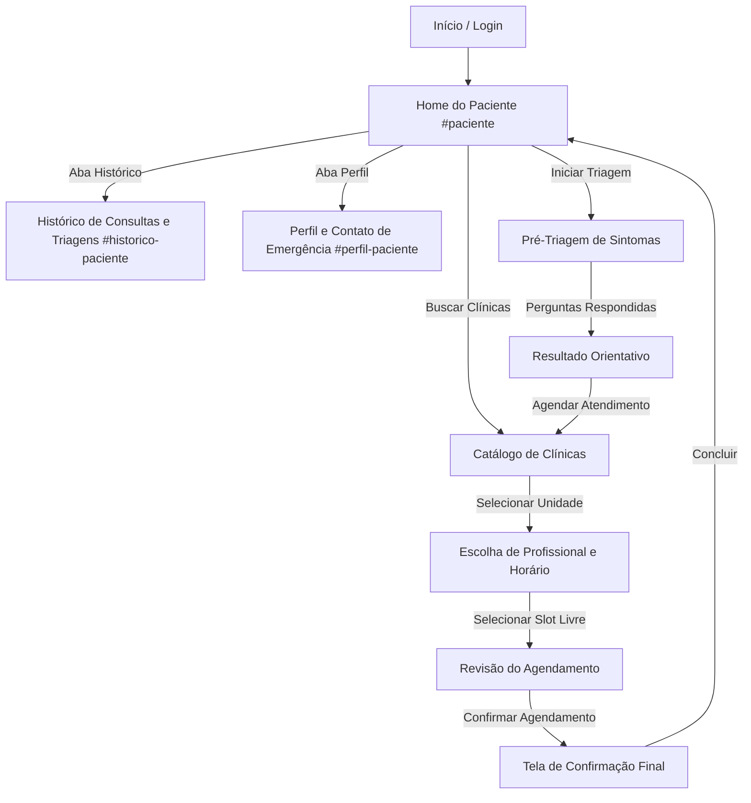
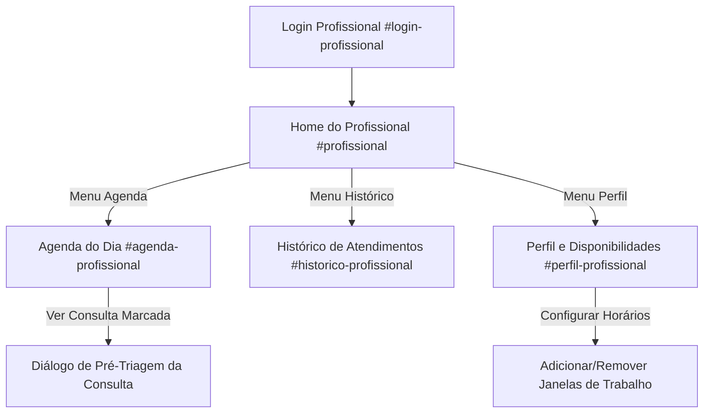
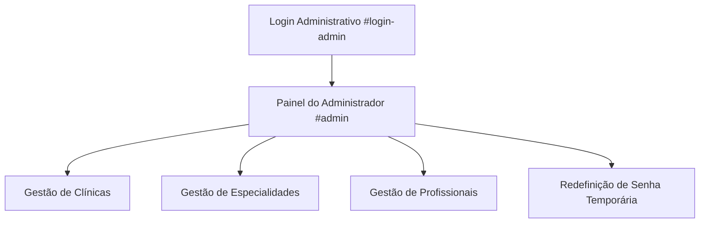

# Fluxos de Navegação e Jornadas de Usuário

Este documento descreve detalhadamente as jornadas de uso, os fluxos de telas e a máquina de estados implementada no front-end do **Desafila** (Saúde na Palma da Mão).

---

## 1. Arquitetura de Navegação e Estados

O aplicativo opera como uma Single Page Application (SPA), onde o componente raiz [`src/App.jsx`](file:///c:/Users/maria/OneDrive/Projetos-Programacao/Projeto_PI_3/saude-palma-mao/src/App.jsx) atua como orquestrador central de telas, combinando:

1. **Sincronização com a Hash da URL (`window.location.hash`):**
   - Garante que a atualização da página (F5) preserve a tela ativa.
   - Evita perda de contexto nas áreas autenticadas de Paciente, Profissional e Administrador.
2. **Cascas de Layout Especializadas:**
   - **`AppLayout`:** Usado nas páginas institucionais e de autenticação (`Home`, `Login`, `Cadastro`, `EsqueciSenha`).
   - **`PatientLayout`:** Casca exclusiva do paciente, fornecendo cabeçalho fixo, botão de acessibilidade, navegação inferior por abas (*Início*, *Histórico*, *Perfil*) e botão de *Sair*.
   - **`ProfessionalLayout`:** Barra de navegação e cabeçalho médico com acesso direto à Home, Agenda, Histórico, Perfil e Sair.
3. **Estado de Jornada (`journey`):**
   - Acumulador em memória que conduz o paciente ao longo do funil de agendamento:
   ```javascript
   const [journey, setJourney] = useState({
     categoria: null,      // Categoria selecionada na triagem
     triagem: null,        // Resposta da triagem (ID salvo na API)
     classificacao: null,  // Orientação (TELECONSULTA, PRESENCIAL, etc.)
     clinica: null,        // Clínica selecionada
     profissional: null,   // Médico selecionado
     especialidade: null,  // Especialidade selecionada
     slot: null,           // Horário escolhido (data, início, fim)
     agendamento: null     // Confirmação gerada pela API
   })
   ```

---

## 2. Jornada do Paciente

O fluxo do paciente foi projetado para ser intuitivo, acolhedor e seguro, guiando-o desde os primeiros sintomas até a confirmação do atendimento médico.



### Etapa 1: Autenticação e Entrada
- O paciente realiza login com e-mail e senha em [`Login.jsx`](file:///c:/Users/maria/OneDrive/Projetos-Programacao/Projeto_PI_3/saude-palma-mao/src/pages/auth/Login.jsx).
- Novos usuários realizam o cadastro em [`Cadastro.jsx`](file:///c:/Users/maria/OneDrive/Projetos-Programacao/Projeto_PI_3/saude-palma-mao/src/pages/auth/Cadastro.jsx), preenchendo obrigatoriamente Nome, CPF, Data de Nascimento, E-mail, Senha e dados opcionais de Contato de Emergência (nome, telefone, e-mail e parentesco).

### Etapa 2: Home do Paciente (`Paciente.jsx`)
- Apresenta saudação personalizada ao paciente e botão direto para o Painel de Acessibilidade.
- Cartões com as próximas consultas agendadas, indicando data, horário, clínica e médico.
- Ação para **Cancelar Consulta**, com confirmação em duas etapas para prevenir cancelamentos acidentais.
- Acesso rápido para iniciar uma nova pré-triagem ou buscar clínicas conveniadas.

### Etapa 3: Pré-Triagem Orientativa (`Triagem.jsx` e `Resultado.jsx`)
- **Seleção de Categoria:** O paciente escolhe a categoria de sintomas (ex: *Respiratórios*, *Neurológicos*, *Gastrointestinais*).
- **Questionário Dinâmico:** As perguntas cadastradas para aquela categoria são carregadas da API. O paciente responde "Sim" ou "Não" para cada pergunta.
- **Resultado da Classificação:** A API processa as respostas e retorna uma orientação:
  - `POSSIVEL_URGENCIA`: Alerta de que o paciente deve procurar uma emergência presencial imediatamente.
  - `PRESENCIAL`: Recomendação para marcar uma consulta presencial.
  - `TELECONSULTA`: Recomendação de que o quadro é elegível para atendimento por telemedicina ou consulta clínica eletiva.
- O resultado orientativo deixa explícito que **não se trata de diagnóstico definitivo**.

### Etapa 4: Escolha de Clínica e Profissional (`Clinicas.jsx` e `EscolhaProfissional.jsx`)
- O paciente seleciona a unidade de atendimento desejada.
- Na tela de escolha médica, seleciona a especialidade e o médico credenciado.
- O sistema busca as janelas de disponibilidade do médico (`/disponibilidades`) e os horários ocupados (`/profissionais/:id/horarios-ocupados`).
- O utilitário [`src/services/agenda.js`](file:///c:/Users/maria/OneDrive/Projetos-Programacao/Projeto_PI_3/saude-palma-mao/src/services/agenda.js) calcula em tempo real os blocos de 30 minutos disponíveis nos próximos 10 dias, impedindo a seleção de horários no passado ou já reservados.

### Etapa 5: Revisão e Confirmação (`Agendamento.jsx` e `Confirmacao.jsx`)
- O paciente revisa os dados da consulta (Clínica, Endereço, Médico, Data, Horário e a Pré-triagem vinculada).
- Ao clicar em "Confirmar Agendamento", a consulta é salva na API (`POST /agendamentos`).
- A tela de confirmação exibe o resumo completo e permite retornar à Home do Paciente ou voltar ao portal institucional.

### Etapa 6: Histórico e Perfil (`HistoricoPaciente.jsx` e `PerfilPaciente.jsx`)
- **Histórico:** Permite alternar entre a listagem de todas as consultas já realizadas ou canceladas e o histórico de pré-triagens efetuadas com suas respectivas classificações.
- **Perfil:** Permite editar telefone pessoal e atualizar as informações do contato de emergência.

---

## 3. Jornada do Profissional de Saúde

O portal do médico foi concebido com foco em praticidade e contexto clínico prévio.



### Etapa 1: Acesso ao Portal (`LoginProfissional.jsx`)
- O médico insere seu e-mail e senha previamente cadastrados pela administração.
- O token gerado armazena o papel `'profissional'`.

### Etapa 2: Home do Profissional (`HomeProfissional.jsx`)
- Exibe o resumo do dia do médico (ex: número de atendimentos agendados, próximos horários).
- Cartões com os próximos pacientes do dia, com atalhos para verificar os detalhes da consulta.

### Etapa 3: Agenda Interativa (`AgendaProfissional.jsx`)
- **Seletor de Data:** Navegação rápida entre os dias da semana (Hoje, Amanhã e datas subsequentes).
- **Lista Cronológica de Atendimentos:** Cada horário do dia exibe:
  - Horários ocupados com o nome do paciente, clínica e status.
  - Faixas de horários livres disponíveis para novos agendamentos.
- **Leitura da Pré-Triagem vinculada:** Clicando no paciente, o médico abre o modal com as perguntas e respostas que o paciente forneceu na triagem, agilizando o entendimento do quadro antes mesmo do paciente entrar no consultório.

### Etapa 4: Histórico de Atendimentos (`HistoricoProfissional.jsx`)
- Lista de atendimentos concluídos ou cancelados, organizados cronologicamente.
- Campo de busca rápida por nome de paciente e filtros de período.

### Etapa 5: Perfil e Gerenciamento de Disponibilidade (`PerfilProfissional.jsx`)
- Exibição de dados profissionais (CRM, especialidades, clínicas conveniadas).
- **Configuração de Janelas de Atendimento:** O médico adiciona dias da semana e intervalos de horário (ex: Terça-feira das 08:00 às 12:00). Essas janelas alimentam imediatamente a oferta de horários visualizada pelos pacientes no fluxo de agendamento.

---

## 4. Jornada do Administrador

Área operacional voltada para o suporte, credenciamento e manutenção do catálogo do sistema.



- **Acesso:** Realizado em [`LoginAdmin.jsx`](file:///c:/Users/maria/OneDrive/Projetos-Programacao/Projeto_PI_3/saude-palma-mao/src/pages/auth/LoginAdmin.jsx) via credenciais configuradas com papel `'admin'`.
- **Painel Central (`Admin.jsx`):**
  - **Clínicas (`ClinicasAdmin.jsx`):** Cadastro de novas unidades com nome, CNPJ, endereço, telefone e horário de funcionamento.
  - **Especialidades (`EspecialidadesAdmin.jsx`):** Cadastro de novas áreas médicas com descrição.
  - **Profissionais (`ProfissionaisAdmin.jsx`):** Credenciamento de novos médicos com CRM, conselho, vínculo de especialidade e unidade clínica. Permite inativar médicos do catálogo.
  - **Senhas Temporárias (`SenhasAdmin.jsx`):** Entrada do e-mail de um paciente ou profissional que perdeu o acesso; a API gera uma senha provisória aleatória de uso único para entrega manual via canal seguro.

---

## 5. Recursos Globais e Acessibilidade

O aplicativo possui acessibilidade integrada via componente [`AccessibilityPanel.jsx`](file:///c:/Users/maria/OneDrive/Projetos-Programacao/Projeto_PI_3/saude-palma-mao/src/components/ui/AccessibilityPanel.jsx) e módulo [`src/services/accessibility.js`](file:///c:/Users/maria/OneDrive/Projetos-Programacao/Projeto_PI_3/saude-palma-mao/src/services/accessibility.js):

- **Fontes Inclusivas:** Suporte à fonte **OpenDyslexic**, com peso e espaçamento desenhados para reduzir a troca de caracteres por pessoas com dislexia.
- **Tamanho da Fonte:** Ajustes em 3 níveis (Padrão, Grande e Extragrande), recalculando os rems através de atributos `data-font-size` no elemento `<html>`.
- **Contraste e Temas:** Opções de *Alto Contraste*, *Tema Escuro* e *Tema Padrão*, assegurando conformidade com as diretrizes WCAG 2.1 AA.
- **Redução de Movimento:** Desativação de animações e transições via `data-motion="reduzido"` para usuários com sensibilidade vestibular.
- As preferências são salvas em `localStorage` e persistem entre sessões e recarregamentos de página.
